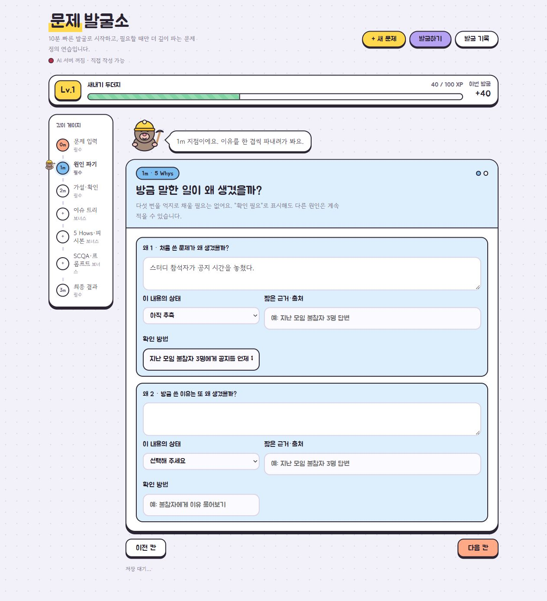
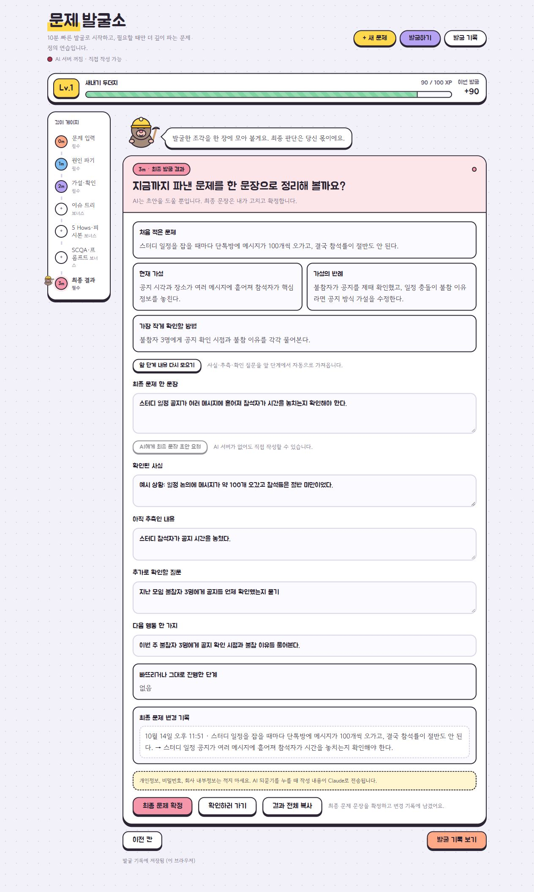
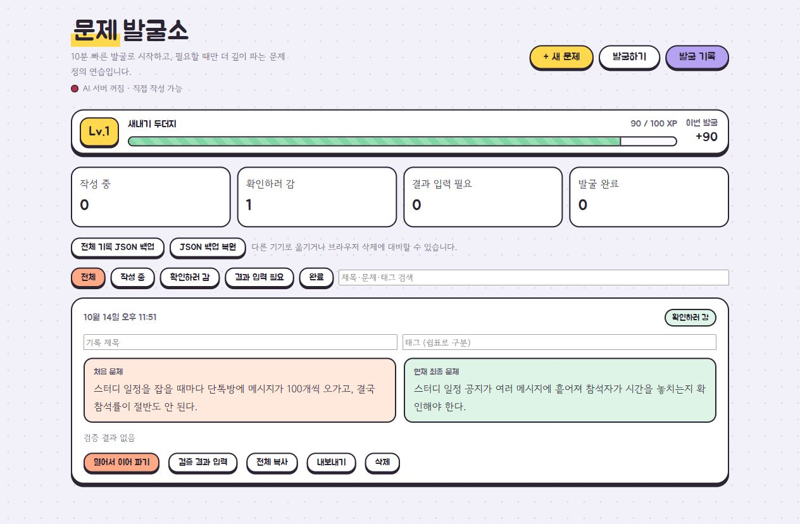
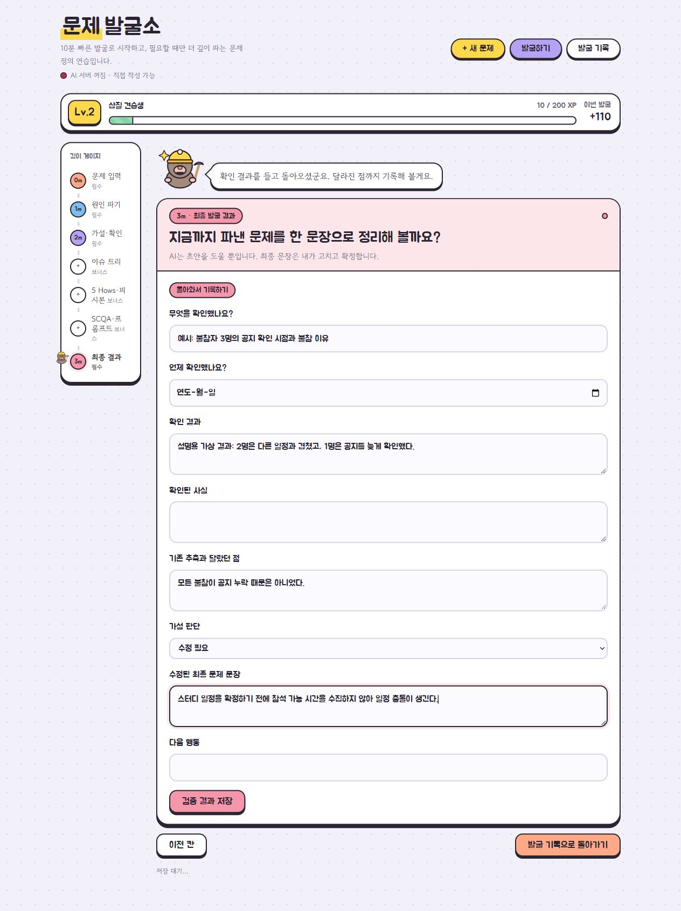

<div align="center">

# 문제 발굴소

**막연한 불편에서, 확인 가능한 문제 한 문장까지.**<br>
두더지와 함께 원인을 묻고, 실제 확인 결과를 들고 돌아오는 문제 정의 연습 도구

`HTML · CSS · JavaScript` · `Python / Node.js` · `Claude API 선택 연동`

[화면과 기능](#화면으로-보는-발굴-과정) · [설계 의도](#설계에서-고민한-점) · [실행 방법](#실행-방법) · [상세 기획서](PLAN.md)

</div>



> 실제 앱을 AI 없이 실행해 촬영했습니다. 스터디 사례와 검증 결과는 기능 설명을 위해 입력한 가상의 예시입니다.

## 왜 만들었나요?

불편한 상황을 발견하면 곧바로 “앱을 만들자” 또는 “알림을 보내자”라는 해결책부터 떠올리기 쉽습니다. 하지만 **누가 어떤 불편을 겪는지, 내가 생각한 원인이 사실인지**가 확인되지 않으면 엉뚱한 문제를 풀 수 있습니다.

문제 발굴소는 생각을 한 번에 정리하라고 요구하는 대신, 카드 한 장씩 질문합니다. 원인을 가설로 남기고 반례와 확인 방법까지 적은 뒤, 나중에 결과를 기록하면서 문제 문장을 고치도록 만들었습니다.

```text
불편 입력 → 원인 질문 → 사실·추측 구분 → 가설과 확인 방법
                                              ↓
문제 수정·확정 ← 돌아와서 결과 기록 ← 실제 확인 ← 최종 문제 한 문장
```

## 화면으로 보는 발굴 과정

### 01. 원인을 적되, 사실로 단정하지 않기

첫 화면의 `왜 1`부터 원인을 한 겹씩 적습니다. 각 답변에는 **확인된 사실 / 아직 추측 / 확인 필요 / 확인 결과와 맞지 않음**을 표시하고 근거·출처·확인 방법을 붙입니다. 다섯 번을 억지로 채우지 않아도 됩니다.

### 02. 발굴한 내용을 한 장으로 모으기



처음 적은 문제와 현재 가설, 반례, 작은 확인 방법을 함께 보여 줍니다. 앞 단계의 사실·추측·확인 질문은 결과에 모이고, **최종 문제 문장은 사용자가 직접 수정하고 확정**합니다. 문장을 바꾼 이력도 남습니다.

### 03. “확인하러 감”과 “완료”를 구분하기



기록은 `작성 중 / 확인하러 감 / 검증 결과 입력 필요 / 발굴 완료` 상태로 관리합니다. 제목·태그·검색·필터로 다시 찾고, 처음 문제와 현재 문제를 비교할 수 있습니다. 전체 기록은 JSON으로 백업·복원할 수 있습니다.

<details>
<summary><strong>돌아와서 실제 확인 결과를 기록하는 화면 보기</strong></summary>



확인한 내용과 날짜, 결과, 기존 추측과 달랐던 점을 입력합니다. 가설을 `유지 / 수정 필요 / 판단 보류`로 정리하고 다음 행동을 적습니다. 위 화면의 답변은 실제 인터뷰 결과가 아닌 설명용 예시입니다.

</details>

## 주요 기능

| 기능 | 사용자에게 필요한 이유 |
|---|---|
| 카드 한 장씩 진행 | 한꺼번에 긴 분석 양식을 채우는 부담을 줄임 |
| 사실·추측 상태와 근거 | 생각한 원인을 확인된 사실과 구분 |
| 가설·반례·작은 확인 방법 | 내 생각을 바꿀 수 있는 조건을 미리 기록 |
| 최종 결과·변경 이력 | 무엇을 알아냈고 생각이 어떻게 바뀌었는지 보존 |
| AI 되묻기·문장 초안 | 사용자가 더 생각할 질문과 초안 제공; 자동 확정 없음 |
| 입력 부족 안내 | 돌아가기·건너뛰기·현재 내용으로 계속 중 선택 |
| 자동 저장·기록 관리 | 새로고침 후 이어 쓰기, 검색·태그·필터·내보내기 |
| 두더지 레벨·경험치 | 실제 작성·구분·검증 행동을 재미있게 이어가기 |

## 설계에서 고민한 점

**기본 흐름은 짧게, 분석 기법은 선택으로.** 이슈 트리·5 Hows·피시본·SCQA·바이브코딩 프롬프트는 `더 깊이 파기`에 뒀습니다. 모든 기법을 끝내야 결과를 얻는 구조가 아닙니다.

**AI 점수와 경험치를 분리했습니다.** 경험치는 실제 행동에 부여합니다. AI 버튼을 반복해서 누르는 것으로 쌓이지 않으며, AI 점검은 현재 내용의 `충분함 / 보완 필요 / 비어 있음`으로 표시합니다.

**확인 전과 확인 후를 나눴습니다.** `확인하러 가기`를 누르면 기록 화면으로 이동합니다. 이후 해당 기록에서 검증 결과를 입력해, 추측으로 결과 칸을 먼저 채우는 일을 줄이려 했습니다.

**기록은 AI 연결과 독립적으로 저장합니다.** API가 없어도 작성·단계 이동·저장·열람이 가능합니다. 기존 브라우저 기록은 새 필드의 기본값을 채워 열고, 건너뛴 단계도 결과에 남깁니다.

## 실행 방법

Windows에서는 [실행.bat](실행.bat)을 더블클릭합니다. Python이 없으면 Node.js로 실행합니다. 직접 실행하려면 둘 중 하나를 선택합니다.

```bash
python server.py
# 또는
node server.mjs
```

[http://localhost:8765](http://localhost:8765)를 엽니다. **API 키 없이도 기본 흐름을 사용할 수 있습니다.**

Claude 되묻기를 사용하려면 `.env.example`을 `.env`로 복사하고 `ANTHROPIC_API_KEY`를 설정합니다. 키는 서버에서 읽으며 브라우저 코드나 발굴 기록에 넣지 않습니다.

## 코드와 기획 살펴보기

| 파일 | 역할 |
|---|---|
| [index.html](index.html) | 카드형 화면, 상태 관리, 기록 저장, 최종 결과 |
| [server.py](server.py) / [server.mjs](server.mjs) | 로컬 웹 서버와 Claude 연결 |
| [PLAN.md](PLAN.md) | 기능을 넣은 이유, 기록 상태, 직접 확인 항목 |

브라우저에서 AI 없는 기본 흐름, 사실·추측 저장, 검증 결과 재입력, 문장 변경 이력, 입력 부족 안내, 상태 필터, 새로고침 저장을 점검하며 개선했습니다. 세부 확인 항목은 기획서에 남겨 두었습니다.

현재 저장 범위는 해당 브라우저입니다. 로그인·클라우드 동기화·공동 편집은 제공하지 않으며, 다른 기기로 옮길 때는 JSON 백업을 사용합니다. 생성형 AI와 함께 기획·구현·개선한 개인 학습 프로젝트입니다.
